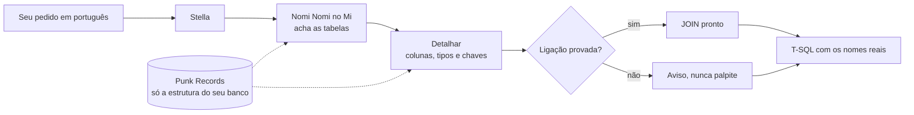

# Vegapunk

**Pergunte em português. Receba o T-SQL certo, com as tabelas, as colunas e os JOINs reais do seu banco.**


O Vegapunk é uma skill do Claude Code para quem trabalha com Microsoft SQL Server, especialmente em sistemas que dão às tabelas nomes em código (`T000123` em vez de `FUNCIONARIOS`). Em vez de o Claude adivinhar esses nomes, o Vegapunk consulta um mapa do **seu** banco, guardado só no seu computador, e responde com o que existe de verdade.

## O que ele faz por você

* 🔎 **Acha as tabelas certas.** Você descreve o que quer ("salário dos funcionários por seção") e ele encontra as tabelas e colunas que guardam esse dado, pela descrição de negócio de cada coluna.
* 🔗 **Entrega o JOIN pronto, e só quando tem prova.** A ligação entre tabelas vem da constraint do banco, do dicionário do seu sistema ou da chave da tabela mãe, inclusive em chave composta. Sem prova, ele avisa em vez de chutar.
* 🧮 **Escreve fórmulas de sistema sem inventar.** Cria, corrige, valida e explica fórmulas usando só funções e sintaxe documentadas. O que não tem suporte documentado aparece como lacuna, com o motivo.
* 🧩 **Resolve pedidos com várias partes.** "Some as horas extras do mês e mostre de qual tabela vem": ele separa cada parte, resolve uma a uma e diz o que você ainda precisa preencher.
* 🛡️ **Nunca toca nos seus dados.** Do banco entra só a estrutura: nomes, descrições, tipos e ligações. Nenhuma linha de cadastro, nenhum valor.
* ⚡ **Sabe T-SQL de verdade.** Otimização, planos de execução, índices, CTEs, window functions, PIVOT/MERGE/APPLY, transações e segurança, com conferência na documentação oficial da Microsoft quando o recurso depende da versão.

## Como fica na prática

> **Você:** quero a lista dos funcionários ativos com o nome da seção de cada um
>
> **Claude (com o Vegapunk):** busca as tabelas, detalha as colunas e devolve a consulta com os nomes do seu banco, o JOIN provado pela chave composta e um aviso se algum filtro depende de um código que você precisa informar.

Nada de "acho que a tabela se chama FUNCIONARIO". Se o nome não veio do seu banco, ele não entra no SQL.

## Resultados

Medidos com pedidos que o motor nunca tinha visto, separados antes de qualquer ajuste.

| O quê | Versão anterior | Agora |
|---|---|---|
| Pedidos com várias partes (fórmula + tabela + cadastro) resolvidos | 74% | **94%** |
| Pedidos com fórmula que executa consulta resolvidos | 70% | **90%** |
| JOINs de chave composta entregues com prova | 0% | **100%** |
| Tabela certa entre as 3 primeiras, num ERP real | 57% | **62%** |
| Função certa entre as 3 primeiras, na busca de fórmulas | 95% | **95%** |

No seu banco, os números dependem principalmente da qualidade das descrições do seu dicionário.

## Comece em 3 passos

Você precisa de Python 3.8+ (só a biblioteca padrão, nada para instalar) e do `sqlcmd` ou do SSMS. Os comandos rodam **da pasta da skill**; no Windows, use `python` (ou `py`) no lugar de `python3`, se for o seu caso.

### 1. Instale

Para todos os projetos:

```bash
git clone https://github.com/tiagocardosobezerra/vegapunk.git ~/.claude/skills/vegapunk
```

```powershell
git clone https://github.com/tiagocardosobezerra/vegapunk.git $HOME\.claude\skills\vegapunk
```

Só para o projeto atual, troque o destino por `.claude/skills/vegapunk`.

### 2. Extraia a estrutura do seu banco

Três consultas prontas leem só o catálogo do SQL Server (`sys.*`), nunca uma tabela de negócio. Crie a pasta e rode, trocando `SERVIDOR` e `SEU_BANCO`:

```powershell
New-Item -ItemType Directory -Force egghead\extracao
```

```bash
sqlcmd -S SERVIDOR -d SEU_BANCO -E -f 65001 -h -1 -y 8000 -i punk_records\extracao\tabelas.sql -o egghead\extracao\tabelas.csv
sqlcmd -S SERVIDOR -d SEU_BANCO -E -f 65001 -h -1 -y 8000 -i punk_records\extracao\colunas.sql -o egghead\extracao\colunas.csv
sqlcmd -S SERVIDOR -d SEU_BANCO -E -f 65001 -h -1 -y 8000 -i punk_records\extracao\relacionamentos.sql -o egghead\extracao\relacionamentos.csv
```

`-E` usa a autenticação do Windows; com login SQL, use `-U usuario` (o `sqlcmd` pede a senha). No macOS/Linux, crie a pasta com `mkdir -p egghead/extracao` e use `/` nos caminhos. Prefere o SSMS? Cada `.sql` explica no cabeçalho como salvar o resultado em arquivo. O schema padrão é `dbo`; para outro, mude a variável `@esquema` no topo de cada consulta.

### 3. Importe e use

```bash
python3 satelites/york.py importar --dir egghead/extracao
python3 satelites/york.py migrar aplicar
python3 satelites/york.py enriquecer --dir egghead/extracao
```

Pronto. Peça qualquer coisa ao Claude sobre o seu banco, ou teste direto:

```bash
python3 stella.py status
python3 stella.py buscar --dominio schema "salário dos funcionários por seção"
python3 stella.py detalhar --dominio schema TABELA1 TABELA2
```

O import calcula sozinho as ligações, a relevância e o ranking de cada tabela, e avisa (sem travar) se alguma ligação apontar para tabela ou coluna que não existe. Tudo fica em `egghead/`, que o `.gitignore` já mantém fora do controle de versão.

## Para ir além

### Permissões no banco

As consultas do catálogo precisam só de `VIEW DEFINITION`. Elas leem nomes, tipos, chaves, descrições (`MS_Description`) e se cada tabela tem alguma linha, nunca quantas.

### Seu ERP tem um dicionário de dados próprio?

Muitos ERPs guardam, em tabelas próprias, a descrição de negócio de cada tabela e coluna e ligações que não existem como constraint. Use: a descrição é o que o motor casa com o seu pedido, e a busca fica muito melhor.

* **Permissão:** para ler o dicionário, é preciso `SELECT` nas tabelas dele. `VIEW DEFINITION` só basta para as consultas do catálogo.
* **Extração:** as consultas do dicionário dependem do ERP e não vêm aqui. Escreva as suas (só tabelas de metadados) e salve os CSVs, no formato abaixo, em `egghead/extracao/dicionario/`.
* **Import:** o dicionário dá as descrições e o catálogo completa a estrutura:

  ```bash
  python3 satelites/york.py importar --dir egghead/extracao/dicionario
  python3 satelites/york.py migrar aplicar
  python3 satelites/york.py enriquecer --dir egghead/extracao
  python3 satelites/york.py enriquecer --dicionario egghead/extracao/dicionario
  python3 satelites/york.py corrigir-direcao --dir egghead/extracao
  ```

  Exportou o dicionário de novo? `python3 satelites/york.py atualizar --dicionario egghead/extracao/dicionario --catalogo egghead/extracao` mostra o que muda; com `--aplicar`, grava.

<details>
<summary><strong>Formato dos CSVs</strong></summary>

UTF-8 ou UTF-16 (o padrão do SSMS), cabeçalho na primeira linha. `tabelas.csv` e `colunas.csv` são obrigatórios; os outros são opcionais.

| Arquivo | Colunas obrigatórias | Colunas opcionais | Observação | Consulta |
|---|---|---|---|---|
| `tabelas.csv` | `tabela` | `descricao`, `tem_dados` | Uma linha por tabela. Score, ranking e contagens são calculados pelo import. `tem_dados` diz só *se* a tabela tem linha, nunca quantas. | [](punk_records/extracao/tabelas.sql) |
| `colunas.csv` | `tabela`, `coluna` | `descricao`, `tipo`, `tamanho`, `precisao`, `escala`, `nulo`, `ordem`, `pk_ordem` | Uma linha por coluna. A `descricao` de negócio é o que o motor casa com o pedido. | [](punk_records/extracao/colunas.sql) |
| `relacionamentos.csv` | `tabela_filha`, `campo_filho`, `tabela_mae`, `campo_mae` | `constraint`, `ordem` | Uma linha por campo de FK; `constraint` agrupa os campos de uma chave composta. Também aceita uma linha por ligação, com os campos em lista na mesma ordem nas duas pontas (`"CODEMP,CODPAI"`). | [](punk_records/extracao/relacionamentos.sql) |
| `sistemas.csv` | `codigo_sistema`, `nome_sistema` | `descricao` | Uma linha por módulo; `codigo_sistema` é o prefixo de 1 letra das tabelas do módulo, quando o seu sistema segue esse padrão. | Vem do dicionário do ERP. |
| `sinonimos.csv` | `termo`, `sinonimo` | — | Uma linha por par ("colaborador" → "funcionário"). Cadeias funcionam. | Vocabulário definido por você. |

Detalhes de cada campo e de como o motor usa cada tabela: [`referencias/schema.md`](referencias/schema.md).

</details>

### Fórmulas de sistema

O Vegapunk trabalha com pacotes de conhecimento em `punk_records/pacotes/`. Um pacote público traz o dialeto e os casos de teste; o texto da documentação é baixado e processado na sua máquina:

```bash
python3 satelites/york.py ingerir --pacote punk_records/pacotes/publico/<pacote>
```

`python3 stella.py status` lista os pacotes instalados. Regras e funções internas da sua empresa vão na camada privada (`punk_records/pacotes/privado/`, ignorada pelo git), a partir do modelo comentado em `punk_records/pacotes/modelo-privado/`. Detalhes em [`referencias/formulas.md`](referencias/formulas.md).

## Como funciona por dentro



| Peça | O que faz |
|---|---|
| **Punk Records** | a base local com a estrutura do seu banco (`egghead/punk_records.db`) e os pacotes de conhecimento |
| **Nomi Nomi no Mi** | o motor de busca: casa o seu pedido com as descrições das colunas e pesa a importância de cada tabela pelas ligações |
| **Stella** | a porta de entrada (`stella.py`): buscar, detalhar, validar, compor, solucionar |
| **York** | a única porta de escrita: importar, migrar, enriquecer, ingerir documentação |
| **Shaka** | compõe, valida e explica fórmulas |
| **Atlas** e **Pythagoras** | os guardas: comportamento idêntico a cada mudança, qualidade medida e isolamento conferido |
| **Edison** e **Lilith** | sugerem sinônimos e geram casos sintéticos para calibrar |

Para conferir a instalação a qualquer momento:

```bash
python3 -m unittest discover -s testes
python3 satelites/atlas.py verificar
python3 satelites/atlas.py isolamento
```

## Estrutura do repositório

```
vegapunk/
├── SKILL.md               # O que o Claude lê: regras e caminhos
├── README.md              # Este arquivo
├── COMO-INSTALAR.md       # Instalação e conferência
├── AVISO.md               # Aviso sobre dados de terceiros
├── LICENSE                # MIT License
├── stella.py              # Porta de entrada
├── satelites/             # York, Shaka, Atlas, Pythagoras, Edison, Lilith
├── nomi_nomi_no_mi/       # Motor de descoberta de schema
├── dominios/              # Schema, fórmulas e soluções
├── punk_records/          # Importação, migrações, consultas de extração e pacotes
├── referencias/           # Fluxos e guias de T-SQL
├── casos/                 # Casos e dados fictícios de teste
└── testes/                # Suíte de testes
```

## Créditos

**Criador:** Tiago Cardoso Bezerra | [tiagocardosobezerra](https://github.com/tiagocardosobezerra)

Batizado em homenagem a Vegapunk, o engenheiro genial de One Piece, personagem reconhecido por dominar sistemas complexos e compartilhar conhecimento de forma clara e acessível.

## Agradecimentos

* Minha esposa **Júlia** e meus filhos **Arthur** e **Aurora**, o porto seguro onde encontro paz, inspiração e a leveza de que preciso todos os dias.
* **Bruna Cardoso Bezerra** | [brunacbezerra](https://github.com/brunacbezerra), por me ensinar tudo o que sei sobre o Claude Code.
* **Hatem Mohamed** | [hmohamed01](https://github.com/hmohamed01), por compartilhar as boas práticas de T-SQL que aplico no Vegapunk.
* **Você**, por usar Vegapunk!

## Aviso sobre dados de terceiros

Este repositório traz só o motor: nenhum metadado de sistema real. Ao importar a estrutura do seu ambiente, você confirma que tem acesso legítimo ou licenciado a ele e se compromete a manter esses dados fora de repositórios públicos. Detalhes em [`AVISO.md`](AVISO.md).

## Licença

MIT License, veja [LICENSE](LICENSE) para detalhes.

---

<p align="center"><strong>Vegapunk</strong>, não adivinha. sabe.</p>

```
                                                                 ░█▒▒▓▓▓▓█                          
                                                    █▓▓         ▓█▓▓▒▒▓▓▓░░                        
                                                 ▓▓▓▓▓▓▓▓       ▒▓██▓▓▒▒▒░            ░▒▓ ░░░      
                                          ░▒▓▒▒ ░▓▓▒▒▓▓░         ▒▓▓▓▒▒▒▓░            ░▒▓▓░▓▓      
                                        ░▓█▒▓▓░ ▓░▒▓▓▓▒          ░▓▓▓▓▒▓▓▓░        ▓▒▓ ▓▓▒░█▓░      
                                        ░██▓▓▒ ░▒▓▒░▒             ░▓█▓▒▓▒▓▓        ░▒█▓░█▓▓░█▒      
                                        ░▓█▓▓▒░░░░▒▒▒▒▒▒▒▒▒░      ░▒░░▒░░▓▓       ░█░▓▓▒░▓▒░█▓      
                                         ░▓░▒▒░░░▒▒▒▒▒▒▒▒▒▒▒░        ▒░░          ░░▒▓▒▓█▓█░█▓  ░▓▒▓
                                          ░▒░░░▒▒▒▒▒▒▒▒▒▒▒▒▒▒▒       ▒░░             ░▒▓▓░▓██▓▒▓█▓▒
                                  ░░░▒▒▒▒▒▒▒▒▒▒▒▒▒▒▒▒▒▒▒▒▒▒▒▒░░      ░░░             ░░░░░▓█████▓▓  
                                ░▒▒▒▒▒▒▒▒▒▒▒▒▒▒▒▒▒▒▒▒▒░░▓▓▓▓█▓▓      ░░░           ░▒██████░▒▓▒    
                              ░▒▒▓▓█▓▓▒▒▒▒▒▒▒▒▒▒░░▓▓▓▒░ ░░▒▓▒        ░░░           ██████████      
                             ░▒▒████▓▒▒▒▒▒▒▒▒▒▓▓▓░  ░░░▒▓░           ▒░░           ███▓▓████░      
                            ░░▒▒▓▓▓▒▒▒▒▒▒▒▓▓▓▒░░░░░░▒▒░              ▒▒░          ▓███████▓▓        
                           ░▒▒▒▒▒▒█▓▒▒▒▓█▓▒ ░░▒▒▒░▒                 ░▒▒▒▓        ░▒░█████▓▓        
                           ░░▒▒▒▒▒▒▒▒▓▓░░░░░░▒░▒▒▒░░▓▓▓▓▓▓▓▒▓░     ▒▒▓█▒░         ░░█████▓          
                           ░░▒▒▒▒▒▓▓▒░░░░░▓  ▓▒▒▓▓▒█▓▓█▒▓▓▒▓▓▓▓▒▒▓▒██▓▒▒░░ ░█▓     ░████▓          
                            ░▒▒▒▒▓▓▒▒▒▒░  ░░▒▒▒▓█▓▓▒▓█▓▓████▓▒▓▓▒████▓▓▓▒▒██▒▒     ▓████            
                             ░░▒▒▒░░     ▒▓▓▒▒▓▒▓▒▒█▓▓█▓▓██████▓▒▒██▓██▒░████     ░████░            
                                        ▓▒▒▒▒▓▓█▓▒▓▓▒▓▒▒▓▓▓▓▓█▓▓▓░▓▓▓▓████▒░ ▒▒░  ▓███▓            
                                      ▓██▓▓▒▓███▒▒▓██▓▓▓▓██▓▒▓▓▒▓▓███▓▒▓████▓▒▒  ░███▒              
                                     ▓▓█▓▓░████▓▓▓▒▒▓▓▓█████████▒▓▒██████▓▒░▓    ████              
                                   ▓▓▓█▒▓▓▓█░▒▒▓█▓██████████████▓▒░███▓██▒█████▓▓███░              
                             ░▓█░████▓█▓▓████▓▓██████▓███████████▒▒████▓██▓██▓▒▓███░                
                               █░▒░░▓██▒▓▒█░▒████████▓▒▓█████████▒▓██████▓█░▒▒░▓██▓                
                                ░███▓███▓█░▓██████████▓▓██████████▓████▓░░░▒▓▒▓▓▒▓▓                
                             ░▓█████▒▓████▓█████████████▓███████▒▓▓██░▓▓█░██▓▒██▒▓█░                
                                ░██████████▒█████████████▓██▒▓▓█▒▓▓██▓▓█████▒████░▓██              
                           ▓░▓██▒▓▒▒████████▒███████████▒▓▓█▓▓▒▓▓▓▓▓▓░▒██▒██████▓▒████░            
                            ░▒▓███▓▒▓▓█▓░███████████▓▓▓██▒░▓▓██▓▓▒▓▓▒▓▓█████▓█████░████            
                                ▒████████░█▒█████▓██▒█████▓▒▒████▓▓█▓░░▓████████▒▓█▒███░            
                               ░██▓███▒▒████▓▒▓▓█▓▓▓▓▓▓█▓█▓▒▒▒▒▓▓▓▓░▓▓▒░░█████████▒▓████            
                               ░▓▓█▓▒▒▓▒████▒▓▓▓▒█▒▒███▒▓▓▓████▒▒▓▓▒▒█▓▒▒▒███▓██▒███████▓          
                               ▒▒█████▓▒▒████▓▒▒▒▒█████▓▒▓████▓███▓▓██▓▓▒▒▓▓███████████▓░          
                              ░█████▓▓▓▓█▒▓█▓▒▒▒▒▒▓▓▓▓▓▓▓▒▒▓▓████▒██▒█▒▓▓▓▓░▓▓▒▒▓▓██████▒          
                              ░████▓▒▒▓█▓▓██▓███░▒▓█▒▒▓▓██████▓▓▒▒░░░▓▒░▒▒▒▒▒███████████            
     ░▒▒           ▓▓         ░█████████████████▒▒▓█▓█▓█████▓▒░░░░░░░███▓▓░░░▒▓▓███▓▓██▓            
      ▓▓▒      █████▒▒         ▓▓██████████▓████▓▒▒█▓▒▓▓██▒▒░▒▒▒▒▒▒▒░███▓▓▒▒▓░▒▓▓▓▓███▓            
▒▒▒▒▒░ ░▒▓░   ▓█████▒▒░░▒██▓▓██████████████▒████▓░▒▓▓███▒▒░ ░▒▒▒▒▒▒▒▒▓██▓▓▒░░░░▓▓▓██▓█▒            
 ▒▒▒▓▓█▓░██▓▓▒█▒█▓█▓████████████▒▓▓▓▓▓▒▓█▓▓▓█▒▓█▒░░░█▓▓▒██▒▓░▒▓▓▒▓▓▓▓▓██▒▒░░░░   ▓░██▒░            
▒▒▓██▓▒▒██▓▓█▓▓█▓█▓████▓▒▓██▒░░ ▓▓▓▓▓▓▒▓█████▓████▒█▓▒▓▒▒██▓▒▓▓▓▒▓▓▓▓▒▒▓▓▒░░▒       ▒░              
  ░░▒▓█▓▓▓▓▓▓█████▒█▒░           ░▒▒▒▓████▓▓█████▓█▒░▓▓██████▓▓▓▓▓▓▓▓▓▒▒▒▒░░                        
    ▒▒██▓▓█▓▒▒▓▓▒                 ░▒▒▓▓█████████▓██▒▓▒░▒▓▓▓█▓▒▓▓▓▓▓▓▓▓▓▒░▓▓                        
▒▒▒▓▓▒▓▓▓▒▒█▓▒                     ▒▒▓██████████▓▓█░▒▓▒▒▓░▓▓▒▓▓▓▓▓▓▓▓▓▓░░░                          
 ▒░░     ▒▒█▓                        ░░███████████▓▓▒▒▒▒▓▒▒░▓▓▓▓▓▓▓▓▓▓▓▒░                          
        ▒▒▓▒                          ▒▒▒░███████▒█░░░░░░░░▓▓▓▓▓▒▓▓▓█▓▓▒░                          
        ░░░                         ▒▒▒▒  ░▒███▓▓█▒     ░▓▓▓▓▓▓▓▓▓▓▓█▓▓▒░                          
                                   ░░▒▓    ▒▓███▒▒     ░▓▓▓▓▓▓▓▒▓▓▓▓▓▓▓▒                            
                               ░▒▒░▒░        █▓▓▓     ░▓▓▓▓▓▓▓▒▓▓▓▓▓▓▓▒░                            
                              ▓▓▒░▒░                  ▒▓▓▓▓▓▓▓▓▓▓▓▓▓▓▒▒                            
                             ░▒▓░▒░                   ▓▓██▓▓▓▓▓▓▓▓▓▓▓▒░                            
                            ░▒▒▒█▒▒▒                  ▓▓██▓▓▓▓▓▓▓▓▓▒▒░                              
                           ░▒▒▓▓▓▒                    ░▓▓▓▓▓▓▓▓▓▓▓▒░                                
                           ▒▓▓▒▒▒▒                     ▒▒▓▓▓▓▓▓▒▒░                                  
                           █▒▒▒▒░                       ░░░░░░░░
```
